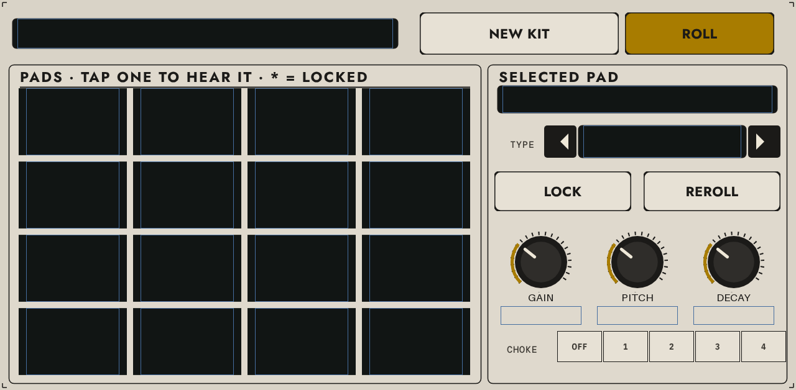
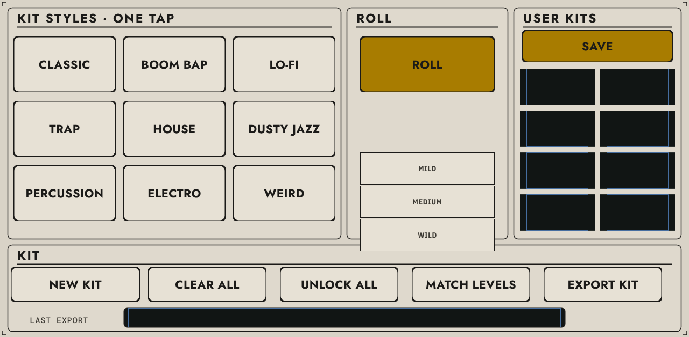

# PotentialKits

**A drum kit from your own samples, one tap at a time.** PotentialKits reaches into your sample folders and pulls out 16 sounds for the pads: a kick, a snare, hats, percussion, and a few surprises. Lock the ones you like, roll the rest, shape each pad's pitch, decay and choke, then save it as a real MPC drum program.



*Instrument plugin · MPC OS 3.x · Gen1 and Gen2 · v1.3.0*

PotentialKits is a fork of **[Lucky Dip](https://github.com/sd88me/mpc-vst-luckydip)** by sd88me. It keeps Lucky Dip's engine (the library scan, the way samples are sorted, the random assignment, level matching and the MPC program export) and Lucky Dip's full history is in this repo. Thanks to sd88me.

Free and open source (MIT), made by **PotentialBreaks**. It runs inside the MPC like its own instruments, with its own touchscreen pages, Q-Link control and project recall, and no computer needed while you play.

**[Download the latest release](../../releases/latest)** · [The PotentialSuite manual](https://github.com/PotentialBreakfast/potential-plugins/blob/main/MANUAL.md) · [Ideas and bugs](../../issues/new/choose)

## What's new compared with Lucky Dip

- **KIT STYLES:** one tap for a whole kit in a style: **CLASSIC**, **BOOM BAP**, **LO-FI**, **TRAP**, **HOUSE**, **DUSTY JAZZ**, **PERCUSSION**, **ELECTRO** or **WEIRD**. A style sets what each pad draws from, its pitch, decay and choke, then dips. Locked pads are left alone.
- **ROLL** with **MILD**, **MEDIUM** or **WILD**, like the rest of the PotentialSuite: MILD gives up to four pads a new sample, MEDIUM makes a new kit with a little pitch and decay, WILD also mixes up what the pads draw from.
- **PITCH, DECAY and CHOKE on every pad.** PITCH runs 12 semitones each way. DECAY shortens a hit (100 % is the whole sample). Pads in the same CHOKE group cut each other off, like closed and open hats. All three are in the exported kit (below).
- **USER KITS:** 8 slots. Tap **SAVE**, then a slot, to keep the whole kit; tap a slot to bring it back in any project. They're kept beside your VST2 Plugins folder, so updates keep them.
- **The KIT page:** the 16 pads as tiles laid out like the MPC's own (A01 bottom left). Tap one to hear it and edit it beside them.
- **Exports as you hear it.** A pad with its pitch, decay or gain changed is written as a new WAV, exactly as it plays in the plugin; the choke groups become the program's mute groups.
- **The PotentialSuite looks** (Print Plate, Night Rack, Colour Block, Vintage, Hi-Fi) and a **MANUAL** page on the MPC's screen.

## What it does

- **Scans your sample folders** and sorts every sample into one of 23 sounds (kick, snare, rim, clap, hat, closed hat, open hat, tom, conga, percussion, crash, ride, cymbal, fx, glitch, vox, bass, synth, stab, chord, lead, pad, other) from its folder and file names. No tagging by hand.
- **Fills 16 pads at random**, like a real drum kit: a kick on A01, a snare on A02, hats, toms and percussion, and the top pads for surprises.
- **Plays the kit** from the pads, a keyboard or the sequencer (MIDI notes 0-15 and 36-51).
- **Lets you steer:** lock the pads you like, reroll the ones you don't, and pick what a pad plays with **TYPE** (kick, snare, bass, vox ...): one tap and the pad gets a new sound of that type.
- **MATCH LEVELS** evens out loud and quiet pads.
- **EXPORT KIT** writes a normal MPC drum program (`.xpm`) with your 16 sounds on pads A01-A16.

## The pages

| Page | What's on it |
|---|---|
| **KIT** | **NEW KIT**, **ROLL**, the 16 pad tiles, and the selected pad: its sample, **TYPE**, **LOCK**, **REROLL**, **GAIN**, **PITCH**, **DECAY** and **CHOKE** |
| **STYLES** | **KIT STYLES**, **ROLL KIT** with MILD / MEDIUM / WILD, **UNLOCK ALL**, **CLEAR ALL** |
| **SAVE** | **USER KITS** (tap **SAVE**, then a slot), **EXPORT KIT**, **MATCH LEVELS** |
| **SETUP** | Where samples come from and kits go, **RESCAN**, copy or link samples on export, **SKIP LOOPS**, **NO DUPLICATES**, **FOLLOW PLAYED PAD**, **MAX SIZE**, and the **LOOK** |
| **MANUAL** | The manual, on the MPC's screen |



## Where it finds your samples

You don't have to type any paths. By default it scans the **Expansions** and **Samples** folders at the top of every drive (the internal drive, SD cards and USB sticks). On the **SETUP** page you can pick any folder at the top of a drive instead, and narrow it to one folder inside it. Press **RESCAN** after changing it. The sample list is saved, so it starts quickly next time.

**WAV** (8, 16, 24 and 32-bit, float, mono or stereo, any sample rate) **AIFF** and **MP3** are read. An MP3 pad is saved as a WAV when you export the kit, because the MPC loads WAVs beside a program.

## Exported kits

- Kits go to **`PotentialKits/Kits`** at the top of the drive the plugin is on (on a Force, its `Expansions/Kits & Patterns`; on a Live III, `MPC Documents/PotentialKits`), or the folder you pick on the SETUP page. Each kit is a folder named `PotentialKits-MMDD-HHMMSS` with the `.xpm` and its samples.
- **COPY SAMPLES** (the default): plain pads are copied as they are; pads with PITCH, DECAY or GAIN changed are written as you hear them.
- **LINK TO ORIGINALS:** the samples stay where they are and the kit links to them. PITCH is set on the MPC's pad; decay and gain are not saved this way.
- **CHOKE** becomes the program's mute groups either way.

## Files

- **`data/`** in the plugin's folder: `index.cache` (the sample list), `prefs.txt` (favourites `F` and rejects `R`, one path per line: edit it to undo a reject), and an optional `potentialkits.conf` you can make yourself:
  ```
  root=/media/<card>/My Samples      # repeatable: every root= line is scanned
  export_dir=/media/<card>/My Kits
  skip_loops=1
  max_mb=5
  ```
  Updates keep this folder.
- **`PotentialSuite Presets/PotentialKits/`** beside your VST2 Plugins folder: the USER KITS, one file each.

## Five looks

PotentialKits comes in five looks: **Print Plate** (the default), **Night Rack**, **Colour Block**, **Vintage** (a late-80s drum machine: warm grey panel, cream keys, an amber display) and **Hi-Fi** (PotentialBox's look: walnut cheeks, a brushed charcoal faceplate, domed knobs lit in the plugin's colour, moulded cream keys, green glass displays). Open the **SETUP** page and tap one of the LOOK keys. The new look shows the next time the plugin loads: take it off the track and add it again, or load your project again.

## Limitations

- **Pads are one-shots.** Hitting a pad again restarts it. One voice per pad.
- **Very long files are cut to 15 seconds** on the pad: PotentialKits is for one-shots.
- **Samples aren't copied into your project.** If you move or delete one, its tile shows `!` before the name.
- **Several PotentialKits tracks share one sample list.** If they use different sources, the last rescan wins.
- **Linked kits** keep decay and gain only in the plugin, not in the MPC program.
- Tested on an MPC One (MPC OS 3.10.1). Lucky Dip, which it is built on, is tested on a Live III and a Force. Please [tell me how it goes](../../issues/new/choose).

## Will it work on my MPC?

| | |
|---|---|
| **Should work on** | Any standalone MPC on **MPC OS 3.10.1 or later**, 32-bit (One, Live, Live II, X, Key 61, Key 37) and 64-bit (Live III, XL). Also Gen1 MPCs on older MPC OS 3.x with the community set-up, and the Force |
| **Not supported** | **MPC OS 2.x** |

## Install

- **With MPC TOOLS:** in the Plugins tab, tap **UPDATE** on PotentialKits.
- **By hand (MPC OS 3.10.1+):** download `PotentialKits-<version>-akai-vst2.zip` from [Releases](../../releases), unzip it, and copy the folder `PotentialBreaks - VST - PotentialKits` into **VST2 Plugins** at the top of a drive. Turn on **Preferences → Enhancements (Beta) → External Plugin Support** and restart.
- **With the Open MPC installer or Plugin Manager:** `-mpc-armv7.zip` for a Gen1 (MPC One, Live, Live II, X, Key, Force), `-mpc-aarch64.zip` for a Gen2.

Then add a track and choose **PotentialKits** as its plugin instrument. Install it one way only.

**Coming from Lucky Dip?** PotentialKits is a separate plugin with its own name, so both can be installed side by side. Your Lucky Dip projects keep using Lucky Dip.

## Ideas, bugs and criticism: all welcome

[Open an issue](../../issues/new/choose). Short reports are fine.

## More from PotentialBreaks

PotentialKits is part of the **[PotentialSuite](https://github.com/PotentialBreakfast/potential-plugins)**: samplers, a record digger and effects that share the same looks, with FX chain presets across Patina, Punch, Grit and Bleed. Try **Break Bus** on a PotentialKits kit: Punch, Grit, Bleed and Patina on its inserts, the same preset name in each.

## Build it yourself

See [BUILD.md](BUILD.md).

## Credits and licence

- **[Lucky Dip](https://github.com/sd88me/mpc-vst-luckydip)** by sd88me (MIT): the kit-building engine (sample classification, random assignment, loudness matching, MPC program export), which came from his [schwung-kit-builder](https://github.com/sd88me/schwung-kit-builder) and [force-kit-builder](https://github.com/sd88me/force-kit-builder). His notes are in [docs/LUCKY_DIP_NOTES.md](docs/LUCKY_DIP_NOTES.md).
- Built with the [Open MPC kit](https://github.com/open-mpc/mpc-vst-plugins) (MIT).
- Fonts: Jost, DM Mono, IBM Plex Sans Condensed, IBM Plex Mono, Bricolage Grotesque and Space Mono (SIL Open Font License 1.1), in `vst/skin/looks/fonts/` with their licences.
- Made with help from Claude (Anthropic).

MIT, see [LICENSE](LICENSE). Not affiliated with or endorsed by Akai Professional or inMusic. MPC is their trademark.

---

## Tested on

MPC One (Gen1) on standard Akai firmware 3.10.1 and on the latest HAKAI firmware (USB-boot method). Gen2 64-bit builds pass Akai's checks but have had limited real-device testing so far.

